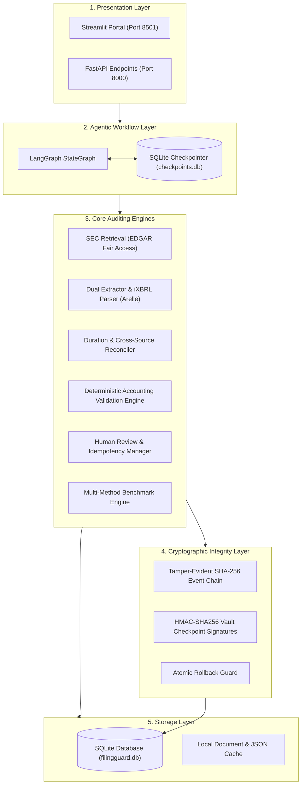

# FilingGuard AI — Master System & Technical Documentation

**Document Version:** 1.0.0  
**Status:** Production Ready  
**Verified Test Baseline:** 211 / 211 Tests Passing (100%)  
**Primary Stack:** Python 3.13, FastAPI, Streamlit, LangGraph, SQLite, Arelle XBRL Engine

---

## 1. Executive Overview

### 1.1 Mission & Purpose
**FilingGuard AI** is an institutional-grade, evidence-first financial filing auditor designed to inspect, reconcile, and validate official SEC Form 10-K filings. 

Standard Large Language Models (LLMs) fail in financial audit environments due to non-deterministic token sampling, numeric sign confusion, context hallucination, and an inability to reconcile XBRL calendar duration contexts. FilingGuard AI solves this by operating **deterministically**: it pairs structured SEC Company Facts API streams with raw Inline XBRL (iXBRL) disclosures, computes strict mathematical and accounting invariant proofs, enforces human auditor review via interruptible stateful workflows, and logs every state change into a tamper-evident cryptographic audit ledger.

### 1.2 Core Capabilities
- **Dual Ingestion**: Real-time retrieval from official SEC EDGAR endpoints respecting SEC Fair Access limits ($\le 10$ req/s).
- **Dual-Source Reconciliation**: Cross-validates SEC Company Facts against parsed Inline XBRL fact streams across 11 audit categories.
- **Duration Matching**: Eliminates false Q4 vs. Annual FY duration clashes by calculating exact day intervals (enforcing 330–380 days for annual metrics).
- **Deterministic GAAP Validation**: Evaluates 15 core rules, including Balance Sheet Equation, Operating Income Presentation, Component Expense Aggregation, YoY Variance Thresholds, Cross-Statement Net Income Proximity, and Segment Disaggregation.
- **Agentic Human-in-the-Loop (HITL)**: Powered by LangGraph with SQLite WAL checkpointing; allows execution to pause on anomalies, survive process crashes/restarts, and resume with zero duplicate execution.
- **Cryptographic Audit Guarantees**: Chained SHA-256 event hashing, HMAC-SHA256 exportable checkpoint signatures, and atomic review transaction rollbacks.
- **Ground-Truth Benchmarking**: Evaluates accuracy against 52 independently verified financial facts across 6 enterprise corporations (AAPL, MSFT, AMZN, WMT, XOM, TSLA).

---

## 2. System Architecture

FilingGuard AI is architected into 5 modular, decoupled layers:



---

## 3. Detailed Component Specifications

### 3.1 SEC Retrieval Engine (`app/sec/`)
- **Rate Limiting**: `SECRateLimiter` enforces thread-safe intervals (minimum 0.15s between calls) adhering to SEC's 10 req/s threshold.
- **User-Agent Compliance**: Validates declared User-Agent format (`FilingGuardAI/1.0 (auditor-team@filingguard.org)`).
- **Submissions & Facts**: Automatically resolves CIK/tickers via SEC ticker directory, fetches candidate 10-K submissions, downloads primary `.htm` documents, and queries `https://data.sec.gov/api/xbrl/companyfacts/`.

### 3.2 Dual Extraction & Semantic Taxonomy Mapping (`app/extraction/`)
FilingGuard AI tracks **10 Canonical Financial Metrics**:
1. `revenue`
2. `operating_income`
3. `net_income`
4. `gross_profit`
5. `operating_cash_flow`
6. `total_assets`
7. `total_liabilities`
8. `stockholders_equity`
9. `cash_and_cash_equivalents`
10. `capital_expenditure`

- **Concept Resolution Hierarchy**: Uses `config/metric_mappings.json` to resolve standard US-GAAP concepts, alternative synonyms, and calculation linkbases.
- **Duration Interval Matching**: Computes calendar day differences ($\text{end\_date} - \text{start\_date}$). Quarterly periods (~90 days) are strictly separated from annual periods (~365 days).
- **Negative Number Detection**: Disambiguates whether accounting parentheses `(1,234)` or XBRL credit/debit balances represent negative values.
- **52/53-Week Fiscal Tolerances**: Accommodates retail and tech fiscal year ends (e.g., Apple ending late September, Walmart ending late January) within $\pm 7$ days of nominal calendar dates.

### 3.3 Deterministic Accounting Validation Engine (`app/validation/`)
Enforces mathematical proofs without probabilistic hallucination:
- **Rule A (Balance Sheet Equation)**: Checks $\text{Assets} = \text{Liabilities} + \text{Equity}$.
- **Rule B (Operating Income Presentation)**: Checks $\text{Gross Profit} - \text{Operating Expenses} = \text{Operating Income}$. If aggregate operating expenses are unstated, automatically aggregates components (e.g., R&D + SG&A).
- **Rule C (Year-over-Year Variances)**: Evaluates annual percentage changes across all 10 metrics against configured threshold (default 40%). Significant shifts trigger a `WARNING`.
- **Rule D (Cross-Statement Net Income)**: Reconciles Income Statement `NetIncomeLoss` with Cash Flow Statement operating activity starting Net Income. Uses statement anchor proximity detection to verify independent statement clusters.
- **Rule E (Segment Breakdown Reconciliation)**: Reconciles disaggregated product and geographic dimensional revenue against consolidated revenue targets within a 1% tolerance.

### 3.4 Agentic Workflow & Human-in-the-Loop (`app/workflow/`, `app/review/`)
Orchestrated via a 7-node LangGraph state machine:
```
retrieve ──> extract ──> score ──> validate ──> review_routing
                                                      │
                            ┌─────────────────────────┴────────────────────────┐
                            ▼                                                  ▼
                   [AUTO_PASS Apply]                               [interrupt("human_review")]
                            │                                                  │
                            ▼                                                  ▼
                        complete                                      resume_workflow()
                                                                               │
                                                                               ▼
                                                                           complete
```
- **Review Routing Triggers**: Any validation failure, validation warning (YoY > 40% or segment discrepancy), missing critical metric, or low quality score automatically interrupts the workflow into `PAUSED_FOR_REVIEW`.
- **Durability & Crash-Resilience**: State is written to SQLite WAL checkpoints after every node. If the process is killed while waiting for review, re-instantiating the service loads the exact state from disk. Resuming proceeds directly from `human_review` to `complete` with zero repeated work.
- **Idempotency Protection**: `IdempotencyManager` prevents duplicate decision execution on accidental double-clicks or client retries using client tokens or deterministic SHA-256 fingerprints.

### 3.5 Cryptographic Integrity & Audit Ledger (`app/audit/`)
- **Chained Event Hashes**: Every event calculates:
  $$\text{event\_hash} = \text{SHA256}(\text{previous\_hash} + \text{canonical\_json}(\text{payload}) + \text{created\_at})$$
  Any retroactive modification invalidates all downstream hashes.
- **HMAC Checkpoint Signing**: Checkpoints are signed using an enterprise HMAC-SHA256 secret key (`AUDIT_SIGNING_SECRET`).
- **Atomic Review Guarantee**: If the audit logger encounters a write error during review submission, the review decision is rolled back immediately via `delete_review()`, raising a `RuntimeError` so no orphan review decision can exist.

### 3.6 Benchmark Evaluation Engine (`app/benchmark/`)
- Evaluates extraction accuracy against 52 verified reference facts across 6 companies (AAPL, MSFT, AMZN, WMT, XOM, TSLA).
- Evaluates:
  - **Baseline A (Simple Tag)**: Raw concept matching.
  - **Baseline B (LLM Offline)**: Structured prompt parsing.
  - **Baseline C (Regex/Table Simulation)**: Table cell text heuristics.
  - **Method D (FilingGuard AI Pipeline)**: Full dual extraction, duration matching, and taxonomy resolution.
- Differentiates between **evaluated accuracy** (exact matches on evaluated cases) and **coverage accuracy** (accounting for missing predictions).

---

## 4. User Interface Architecture (Streamlit Dashboard)

The Streamlit UI runs at `http://localhost:8501`:

| Page | File | Key Functions |
|---|---|---|
| **Overview / Home** | `dashboard/Home.py` | System health, architecture overview, quick-start controls. |
| **1. Company Selection** | `pages/1_Company_Selection.py` | Live SEC CIK/ticker lookup, filing metadata, document fetching. |
| **2. Extraction Results** | `pages/2_Extraction_Results.py` | Dual fact tables (Company Facts vs iXBRL), reconciliation status. |
| **3. Validation** | `pages/3_Validation.py` | Accounting rule outcomes, tolerance variances, mathematical proofs. |
| **4. Human Review** | `pages/4_Human_Review.py` | KPI summary cards, 'Why Flagged' root cause box, source excerpts, Approve/Correct/Reject forms. |
| **5. Accuracy Report** | `pages/5_Accuracy_Report.py` | Benchmark comparison matrices, evaluated accuracy graphs, missing fact reporting. |
| **6. Audit History** | `pages/6_Audit_History.py` | Cryptographic Merkle chain visualization, verification tool, HMAC export. |

---

## 5. API Reference Summary

FastAPI runs at `http://localhost:8000` (Swagger docs at `/docs`):

| Method | Endpoint | Description |
|---|---|---|
| `GET` | `/api/v1/health` | System health, database connection, and component status. |
| `POST` | `/api/v1/filings/retrieve` | Fetch and index latest 10-K from SEC EDGAR. |
| `GET` | `/api/v1/metrics/{accession_number}` | Retrieve extracted canonical metrics and confidence scores. |
| `POST` | `/api/v1/validations/{accession_number}/run` | Execute deterministic financial validation rules. |
| `GET` | `/api/v1/reviews/queue` | List pending and escalated human review items. |
| `POST` | `/api/v1/reviews/submit` | Submit human review decision (Approve, Correct, Reject). |
| `POST` | `/api/v1/workflows/start` | Start LangGraph filing audit state machine. |
| `POST` | `/api/v1/workflows/resume` | Resume an interrupted workflow thread with review decision. |
| `GET` | `/api/v1/audit/trail/{accession_number}` | Retrieve chained audit trail events. |
| `POST` | `/api/v1/audit/verify` | Verify cryptographic SHA-256 chain integrity. |
| `POST` | `/api/v1/benchmark/run` | Execute multi-method benchmark suite. |

---

## 6. Verification & Test Suite

The test suite validates unit, integration, live SEC, and workflow functions.

```powershell
# Run full test suite
.venv\Scripts\python.exe -m pytest -v

# Run live 8-point gap demonstration script
.venv\Scripts\python.exe scratch/demo_gaps.py
```

### Test Suite Results Breakdown (211 Tests)
- `tests/api/`: Health, Filings, Metrics, Validations, Reviews, Workflows, Audit, Benchmark (35 tests)
- `tests/unit/`: SEC Client, XBRL Parsing, Taxonomy, Scoring, Engine, Resume, Idempotency, Hashing (163 tests)
- `tests/integration/`: Live SEC EDGAR Ingestion, Company Facts, iXBRL, Reconciliation, Scoring, Validation, Workflow Pause/Resume, Benchmark (13 tests)
- **Total Result**: **211 Passed, 0 Failed in 23.49s**.

---

## 7. Deployment & Operational Guide

### 7.1 Environment Configuration (`.env`)
```bash
# Server & Logging
ENVIRONMENT=production
LOG_LEVEL=INFO

# SEC EDGAR Compliance (Mandatory descriptive string)
SEC_USER_AGENT=FilingGuardAI/1.0 (auditor-team@filingguard.org; Financial Statement Audit Platform)
SEC_REQUEST_TIMEOUT=30

# Cryptographic Audit Secret (Vault Key)
AUDIT_SIGNING_SECRET=fg_audit_secure_hmac_secret_2026_vault_key

# Database Paths
DATABASE_URL=sqlite:///data/database/filingguard.db
CHECKPOINT_DB_PATH=data/database/checkpoints.db
```

### 7.2 Service Startup
```powershell
# Terminal 1: FastAPI Backend
.venv\Scripts\python.exe -m uvicorn app.main:app --host 0.0.0.0 --port 8000

# Terminal 2: Streamlit Dashboard
.venv\Scripts\python.exe -m streamlit run dashboard/Home.py --server.port 8501
```
